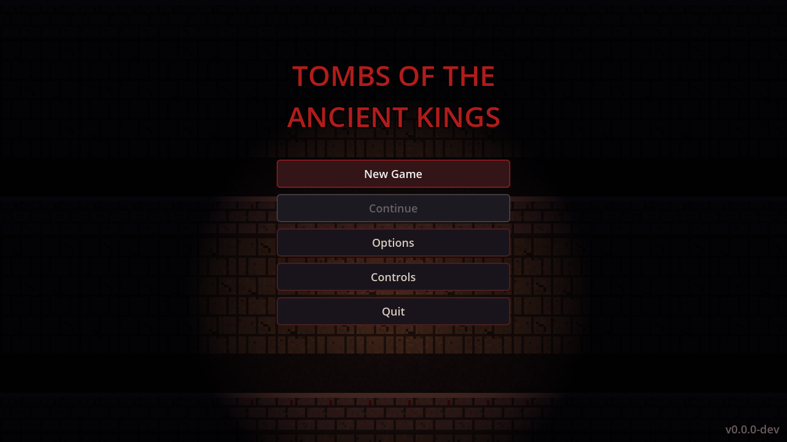
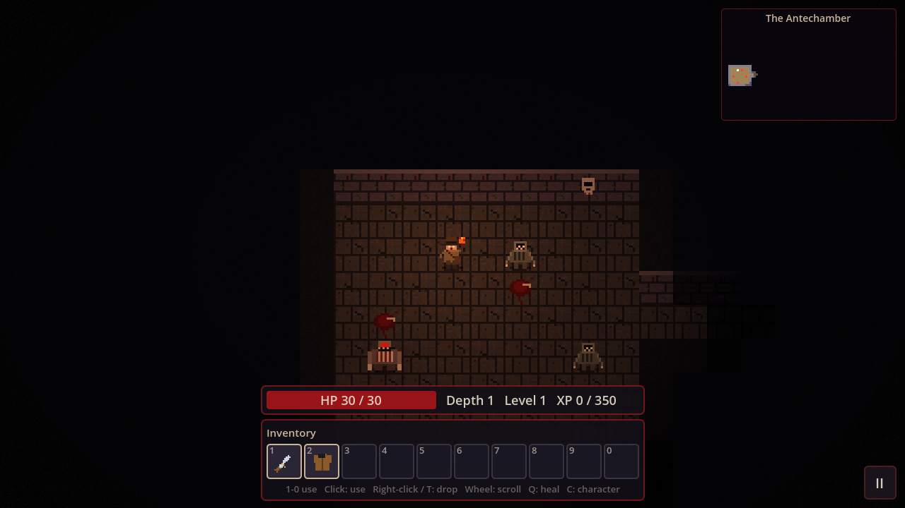
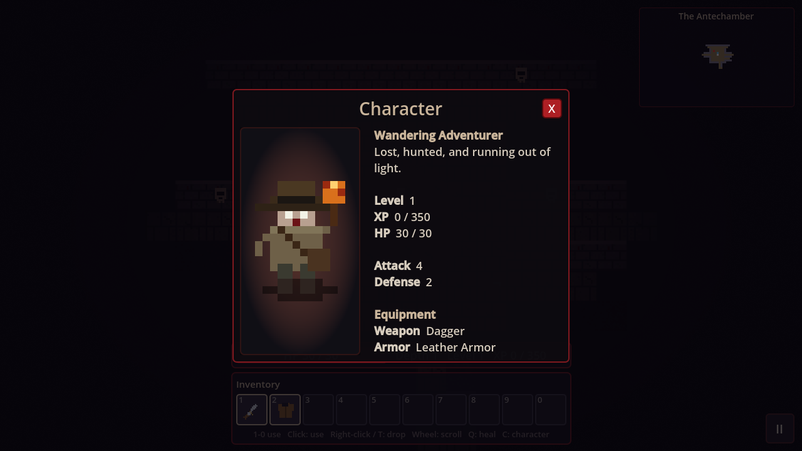

# Tombs of the Ancient Kings (ToTAK)

A turn-based, pixel-art **horror roguelike** for **Windows, macOS and Linux**.
Descend through procedurally generated tombs that get darker the deeper you go, survive ghouls and abominations with a single guttering torch, loot scrolls, potions, weapons and armor,
level up, and see how deep you can get before the dark claims you. Low health pulses the edges of your screen red and fills your ears with your own heartbeat.

| Main menu | In the dungeon | Character sheet |
|---|---|---|
|  |  |  |

**Highlights:** pixel-art tiles with a flickering torch and fog of war, a dungeon that grows darker and stranger every
floor, minimap, 10-slot number-key hotbar with stackable consumables, hold-to-walk movement, quick-save, autosave,
versioned saves, and in-game update notices. Works on Windows, macOS and Linux with automatic releases.

Built with [Godot 4](https://godotengine.org). This is a ground-up remake of the original Python/ASCII game
(still available in [`legacy/`](legacy/)).

---

## Contents
1. [Download and install](#download-and-install)
2. [Updating](#updating)
3. [How to play](#how-to-play)
4. [Where your saves live](#where-your-saves-live)
5. [Troubleshooting](#troubleshooting)
6. [Build from source](#build-from-source)
7. [Project layout](#project-layout)
8. [How releases work](#how-releases-work)
9. [Contributing / license / credits](#contributing--license--credits)

---

## Download and install

Get the newest files from the **[Releases page](https://github.com/AWeebTaku/ToTAK/releases/latest)**.
Every release lists the same set of files (replace `X.Y.Z` with the version):

| Platform | File | Notes |
|---|---|---|
| Windows 10/11 (64-bit) | `ToTAK-X.Y.Z-windows-Setup.exe` | Installer |
| macOS 10.15+ (Intel and Apple Silicon) | `ToTAK-X.Y.Z-macos.dmg` | Universal app |
| Debian, Ubuntu, Linux Mint, Pop!_OS | `ToTAK-X.Y.Z-linux-debian-ubuntu-amd64.deb` | Native package |
| Fedora, openSUSE, RHEL and derivatives | `ToTAK-X.Y.Z-linux-fedora-opensuse-x86_64.rpm` | Native package |
| Arch, Manjaro, EndeavourOS | `ToTAK-X.Y.Z-linux-arch-x86_64.pkg.tar.zst` | Native package |
| Any other Linux x86_64 | `ToTAK-X.Y.Z-linux-x86_64.AppImage` or `.tar.gz` | Runs without installing |
| All | `SHA256SUMS` | Checksums to verify downloads |

**System requirements:** any 64-bit machine from the last ~10 years with OpenGL 3.3 (or OpenGL ES 3.0) capable graphics
(integrated graphics is fine), about 100 MB of disk space, and a keyboard. A mouse is optional.

### Windows
1. Download `ToTAK-X.Y.Z-windows-Setup.exe` and run it.
2. **SmartScreen warning ("Windows protected your PC")?** The installer is not code-signed. Click **More info → Run anyway**.
3. Choose an install location (per-user by default, no administrator rights needed; pick "for all users" in the
   privilege dialog if you want a system-wide install), optionally tick *Create a desktop shortcut*, and finish.
4. Start the game from the Start menu entry **Tombs of the Ancient Kings**.

To uninstall use *Settings → Apps*. Your saves are kept (see [saves](#where-your-saves-live)).

### macOS
1. Download `ToTAK-X.Y.Z-macos.dmg`, open it, and drag **Tombs of the Ancient Kings** onto the **Applications** shortcut.
2. The app is not notarized by Apple, so the first launch is blocked. Do **one** of these:
   - In Finder, **right-click (or Control-click) the app → Open → Open**; or
   - open *System Settings → Privacy & Security*, scroll down and click **Open Anyway**; or
   - in Terminal: `xattr -cr "/Applications/Tombs of the Ancient Kings.app"`
3. After that first launch it opens normally.

### Linux

Pick the package for your distribution. All of them install the same game: a `totak` command, an application-menu entry
(**Tombs of the Ancient Kings**, under Games) and the icon. Packages are for 64-bit x86 (amd64) only.

**Debian, Ubuntu, Linux Mint, Pop!_OS** (`.deb`)
```bash
sudo apt install ./ToTAK-X.Y.Z-linux-debian-ubuntu-amd64.deb
```

**Fedora, RHEL, Rocky, Alma** (`.rpm`)
```bash
sudo dnf install ./ToTAK-X.Y.Z-linux-fedora-opensuse-x86_64.rpm
```

**openSUSE** (`.rpm`)
```bash
sudo zypper --no-gpg-checks install ./ToTAK-X.Y.Z-linux-fedora-opensuse-x86_64.rpm
```
(The packages are not GPG-signed, hence `--no-gpg-checks`.)

**Arch, Manjaro, EndeavourOS** (`.pkg.tar.zst`)
```bash
sudo pacman -U ./ToTAK-X.Y.Z-linux-arch-x86_64.pkg.tar.zst
```

Run it from the menu or with `totak`. Remove it with `sudo apt remove totak`, `sudo dnf remove totak`,
`sudo zypper remove totak` or `sudo pacman -R totak`. Your saves stay in your home folder.

**AppImage (any distro, nothing to install)**
```bash
chmod +x ToTAK-X.Y.Z-linux-x86_64.AppImage
./ToTAK-X.Y.Z-linux-x86_64.AppImage
```
- If it complains about FUSE (common on Ubuntu 22.04+), either install it (`sudo apt install libfuse2`, Fedora:
  `sudo dnf install fuse-libs`, Arch: `sudo pacman -S fuse2`) or run without FUSE:
  `./ToTAK-*.AppImage --appimage-extract-and-run`.
- Optional: use [AppImageLauncher](https://github.com/TheAssassin/AppImageLauncher) or *Gear Lever* to add it to your app menu.

**Tarball (any distro, no FUSE, no root)**
```bash
tar -xzf ToTAK-X.Y.Z-linux-x86_64.tar.gz
cd ToTAK-X.Y.Z-linux
./ToTAK.x86_64
```

Other distributions (NixOS, Void, Alpine and so on) should use the AppImage or tarball. The Linux builds need glibc,
so musl-based systems such as Alpine need a glibc compatibility layer.

Verify a download (any OS): `sha256sum -c SHA256SUMS --ignore-missing` (Linux), `shasum -a 256 -c SHA256SUMS --ignore-missing` (macOS),
or `Get-FileHash <file>` (Windows PowerShell) and compare with `SHA256SUMS`.

---

## Updating

- **In the game:** on startup the menu checks GitHub for a newer release (one small request, nothing is sent about you).
  If one exists a green banner appears at the top of the menu: click it to open the download page.
  You can turn the startup check off, or check manually, under **Options → About**.
- **Windows:** just run the newer `Setup.exe`. It detects the existing installation and **upgrades it in place**.
- **macOS:** drag the new app over the old one in Applications (choose *Replace*).
- **Linux packages:** install the newer `.deb` / `.rpm` / `.pkg.tar.zst` with the same command as before; it upgrades in place.
- **Linux AppImage / tarball:** download the new file and delete the old one.
- **Saves carry over.** Save files are versioned and migrated automatically when a newer game opens an older save.
  (A save made by a *newer* game than the one you launch is refused rather than corrupted. Update the game instead.)

---

## How to play

Reach the stairs `>` on each floor and go down. The tomb gets darker and stranger the deeper you descend, and the minimap (top right) fills in as you explore. Monsters chase you when they can see you. Kill them for XP, and pick a
stat to raise each time you level up. If you die, your save is deleted: it is a roguelike.

| Action | Keys |
|---|---|
| Move / melee attack | `W` `A` `S` `D`, arrow keys, numpad, or vi keys `h j k l y u b n` (diagonals: `y u b n` or numpad). **Hold a key to keep walking** (it stops if you are hurt or blocked) |
| Wait a turn | `.` / `Space` / numpad `5` |
| Pick up item | `G` |
| Use item / equip | Number keys `1`-`9`, `0` (top row) use the matching hotbar slot, or click the slot |
| Scroll inventory | Mouse wheel (the hotbar shows 10 slots at a time) |
| Drop item | Right-click a slot, or `T` then `1`-`0` |
| Quick-use health potion | `Q` |
| Take stairs down | `>` (Shift + `.`) while standing on the stairs |
| Character sheet (stats and gear) | `C`, or click the health bar |
| Look around | `/` or `X` (or hover with the mouse) |
| Message log (pin / unpin) | `Enter`: the log fades out on its own and reappears on new events |
| Message history | `V` |
| Minimap show / hide | `M` |
| Help | `?` / `F1` |
| Quick save | `F5`: a small floppy-disk icon appears briefly. The game also autosaves silently after every turn |
| Pause menu (save and quit) | `Esc`, or the **II** button in the bottom-right corner |

**Enemies:** Ghouls (10 HP) lurk from the first floor. Abominations (16 HP, hit harder, worth more XP) join them from depth 3.

**Items** (consumables stack in one slot): **Health Potion** heals, **Lightning Scroll** zaps the nearest visible enemy,
**Confusion Scroll** makes a targeted enemy stumble randomly, **Fireball Scroll** burns an area (it hurts you too if you
stand in it). Weapons raise attack, armor raises defense. The game **autosaves after every turn**; `F5` quick-saves
and shows a small save icon.

**Tips:** your torch only lights what is close, so retreat down corridors to fight one enemy at a time. Hold a
movement key to run, but it stops the moment something hurts you. Low health pulses the screen red.

---

## Where your saves live

| OS | Folder |
|---|---|
| Windows | `%APPDATA%\ToTAK` |
| macOS | `~/Library/Application Support/ToTAK` |
| Linux | `~/.local/share/ToTAK` (or `$XDG_DATA_HOME/ToTAK`) |

Files: `save.json` (current run) and `settings.cfg` (sound, update check). Back up or delete these freely.

---

## Troubleshooting

| Problem | Fix |
|---|---|
| Black window / crash on start (Linux, old GPU) | Run with `--rendering-driver opengl3`, e.g. `./ToTAK.x86_64 --rendering-driver opengl3`; make sure Mesa/GPU drivers are installed |
| Wayland issues (Linux) | Try `--display-driver x11` |
| `.deb` install says a dependency is missing | Run `sudo apt install -f`, or install with `sudo apt install ./file.deb` (not `dpkg -i`) so dependencies are fetched |
| `.rpm` asks for `libGL.so.1` or similar | Install your GPU driver / Mesa (`sudo dnf install mesa-libGL`) |
| AppImage says "dlopen(): error loading libfuse.so.2" | Install `libfuse2` or use `--appimage-extract-and-run` |
| macOS says the app "is damaged" | Run `xattr -cr "/Applications/Tombs of the Ancient Kings.app"` and open it again |
| Windows SmartScreen blocks the installer | *More info → Run anyway* (installer is unsigned) |
| "That save could not be loaded" | Delete `save.json` from the [saves folder](#where-your-saves-live) and start a new game |
| No sound | Menu → *Options → Sound effects*; check your OS audio output |
| Report a bug | [Open an issue](https://github.com/AWeebTaku/ToTAK/issues) with your OS, version (bottom-right of the menu), and what happened |

---

## Build from source

You only need this to hack on the game. Players should use the [releases](#download-and-install).

Requirements: **[Godot 4.7](https://godotengine.org/download/)** (standard build, not .NET). Python 3 with
Pillow is only needed to regenerate art (`pip install pillow`).

```bash
git clone https://github.com/AWeebTaku/ToTAK.git
cd ToTAK

godot --path . --editor        # open in the editor (first open imports assets)
godot --path .                 # or just run the game
```

**Run the tests** (headless, exit code 1 on failure):
```bash
godot --headless --import      # once, to import assets
godot --headless -s tests/run.gd     # game logic: procgen, FOV, combat, items, stacking, saves, migrations
godot --headless -s tests/smoke.gd   # boots the UI: menus, hotbar, hold-to-walk, stairs, quick save, close buttons
godot --headless -s tests/fuzz.gd    # random-bot soak test: ~9,000 turns across 40 seeds, with save/load round-trips
```
CI runs all three on every pull request and before every release. (`tests/smoke.gd` ends with Godot's usual harmless
"resources still in use at exit" notice.)

**Make your own build:** install the matching export templates (*Editor → Manage Export Templates*), then:
```bash
mkdir -p build/linux build/windows build/macos
godot --headless --export-release "Linux"   build/linux/ToTAK.x86_64
godot --headless --export-release "Windows" build/windows/ToTAK.exe
godot --headless --export-release "macOS"   build/macos/ToTAK.zip
```
The installers and packages are produced by CI; see [`.github/workflows/release.yml`](.github/workflows/release.yml) and
[`installer/`](installer/) to reproduce them by hand. The Linux ones are plain shell scripts you can run yourself after
exporting the Linux build:
```bash
installer/linux/build-deb.sh  0.1.0 build/linux/ToTAK.x86_64 out/totak.deb                  # needs dpkg-deb
installer/linux/build-rpm.sh  0.1.0 build/linux/ToTAK.x86_64 out/totak.rpm                  # needs rpmbuild
installer/linux/build-arch.sh 0.1.0 build/linux/ToTAK.x86_64 out/totak.pkg.tar.zst          # needs makepkg, run as non-root
```

**Regenerate the art and sound effects:** `python3 tools/gen_assets.py` (writes `assets/tiles.png`, the icons, the save icon and
`assets/sfx/*.wav`; all of it is original and CC0). If you add a tile, append its name to `NAMES` in both
`tools/gen_assets.py` and `game/view/sprites.gd` (same order).

---

## Project layout

```
game/core/    pure game logic (no rendering): map, procgen, FOV, actors, items, actions, AI, saves, versioning
game/data/    monsters.json, items.json, spawns.json: edit these to rebalance or add content
game/view/    map rendering, sprite atlas, depth theming, vignette shader
game/ui/      main menu, game scene, HUD (hotbar, minimap, log), controls screen, theme
assets/       tileset, icons, sound effects
tests/        headless tests: run.gd (logic), smoke.gd (UI), fuzz.gd (soak)
tools/        gen_assets.py: regenerates all art and audio
installer/    Windows (Inno Setup) and Linux (AppImage, deb, rpm, Arch) packaging files
.github/      CI and release workflows, issue and PR templates
docs/         README screenshots
legacy/       the original Python/tcod game, kept for reference
```

Adding a monster or item is a data change: add an entry to `game/data/*.json` (and a sprite name from
`assets/tiles.png`/`tools/gen_assets.py`), then list it in `spawns.json` with a floor and weight.

---

## How releases work

Releases are fully automatic ([`release.yml`](.github/workflows/release.yml)). On every push to `main` that touches the game
(`game/`, `assets/`, `project.godot`, `export_presets.cfg`, `installer/`):

1. The workflow reads the **latest release tag** and computes the next version from it:
   **patch** by default (`1.4.2 → 1.4.3`). Put `#minor` or `#major` anywhere in a commit message since the last release to
   bump that part instead. You can also run the workflow manually (*Actions → Release → Run workflow*) and pick the bump.
   The very first release is `v0.1.0`.
2. All tests run (`ci.yml`: logic, UI smoke, soak). A failure stops the release.
3. The game is exported for Windows, Linux and macOS with Godot 4.7 and the version is stamped into the build.
4. Packages are built: Windows `Setup.exe` (Inno Setup, fixed AppId so it upgrades in place), macOS `.dmg`
   (universal, ad-hoc signed), Linux `.AppImage`, `.tar.gz`, `.deb`, `.rpm` and Arch `.pkg.tar.zst`, plus `SHA256SUMS`.
   The `.deb` is test-installed on the Ubuntu runner, the `.rpm` in a Fedora container and the Arch package in an Arch
   container, and each must start the game headlessly before the release is published.
5. A GitHub Release `vX.Y.Z` is created with a download table plus notes generated from the commits **since the previous
   release**, and all files attached.

**Rebuilding without a new version:** run *Actions → Release → Run workflow* with **bump = none**. It rebuilds every package
from the current `main`, replaces the assets of the latest release (same version number) and moves its tag to the current
commit. Useful after adding a new package type or fixing packaging.

Changes that only touch docs, `README.md`, `CHANGELOG.md` or `legacy/` do not trigger a release, and a commit message
containing `[skip ci]` skips all workflows.

**First-time setup for a fork or new repository**
1. Push this repository to GitHub (branch `main`).
2. *Settings → Actions → General → Workflow permissions*: choose **Read and write permissions** (the workflow also requests
   `contents: write` itself, but an organisation policy can override that).
3. Push any change under `game/` (or run *Actions → Release → Run workflow*). The first release appears as `v0.1.0`.
4. In-game update checks and the bug-report template read the repository name from `game/core/version.gd`
   (`REPO`) and the README links. Change them if you fork under another name.

*Optional signing:* the pipeline works without any secrets. To remove the SmartScreen/Gatekeeper warnings you would add
code-signing certificates (Windows) and an Apple Developer ID plus notarization (macOS) to the workflow. Not set up yet.

---

## Contributing / license / credits

Issues and pull requests are welcome; CI runs the tests on every PR. Please keep game rules in `game/core` (so they stay
testable headless) and content in `game/data`.

Licensed under the MIT License (see [LICENSE](LICENSE)). Pixel art, icons and sound effects are generated by `tools/gen_assets.py`
and are CC0. Built with the [Godot Engine](https://godotengine.org) (MIT). The original game followed the
[libtcod roguelike tutorial](http://rogueliketutorials.com/).
